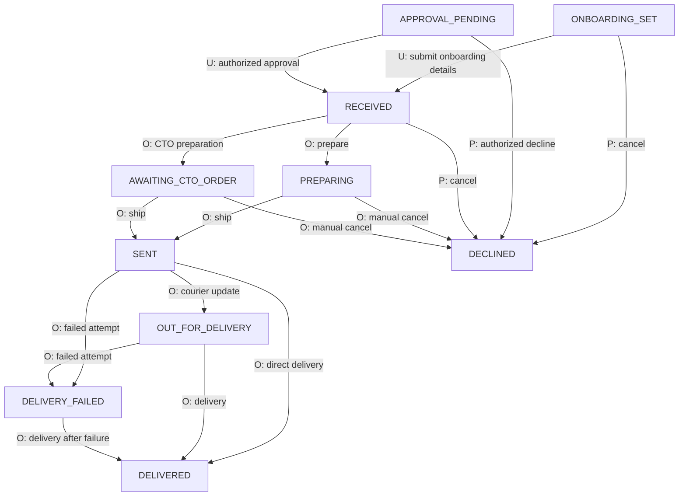
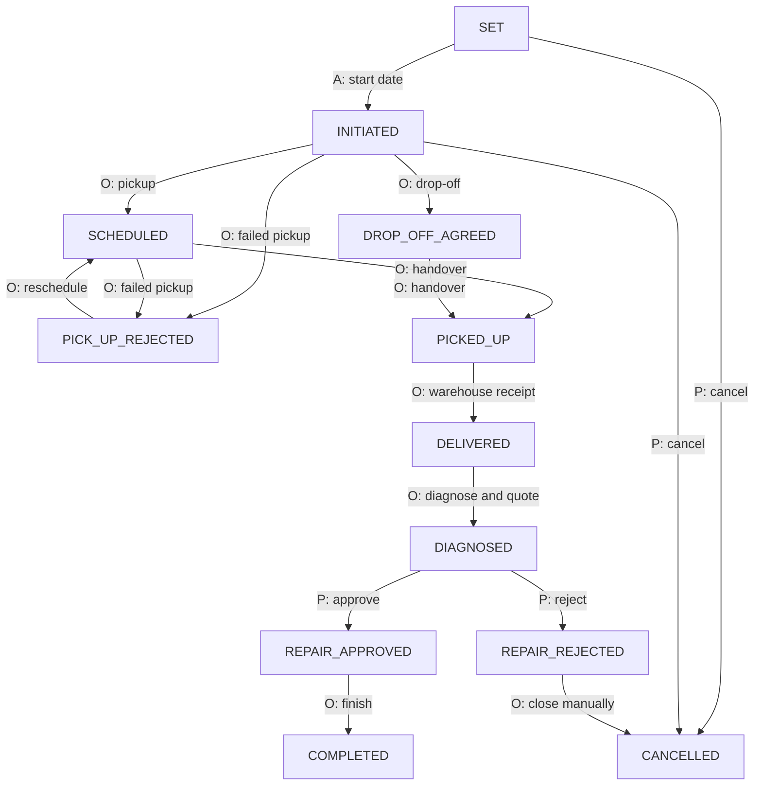
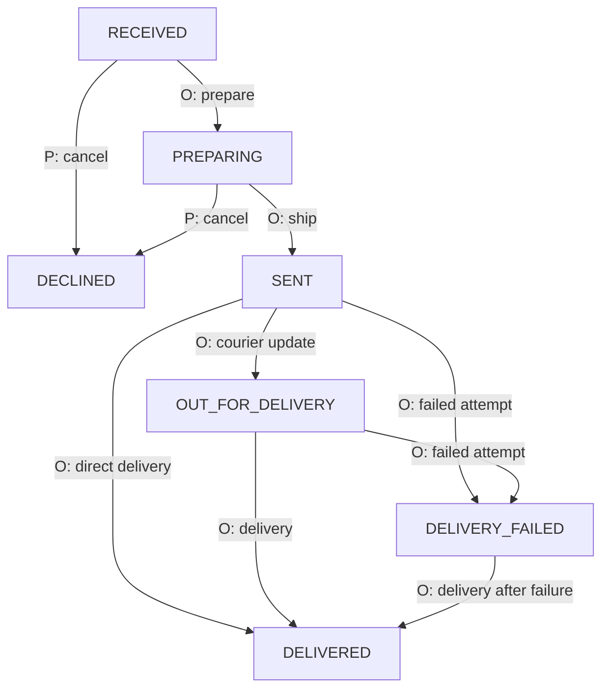
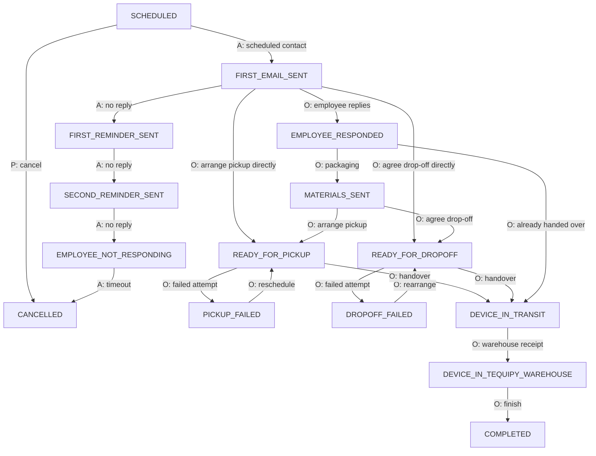

Read `state` from the resource returned by the Integration API. These diagrams show
main routes and useful shortcuts. The transition tables list every lifecycle
transition allowed by each service's domain model. Additional permission, billing
and equipment checks still apply.

**Actors:** **P** = partner through a regular Integration API operation;
**O** = Tequipy operations, including coordination with the employee or carrier;
**A** = scheduled automation; **U** = employee or company administrator in the
Tequipy application, outside the Integration API. On dev, the partner can replace selected O/A steps
with the [Simulation API](/sandbox/simulation-api). That does not expose the same
operational actions in production. See each guide's action table for that narrower
simulation contract.

Final states are identified below each diagram. Administrative `DELETED` states
are not partner cancellation states. Delay flags and cost actions do not create
new lifecycle states.

## Orders

The normal lifecycle has final states `DELIVERED` and `DECLINED`. `ARCHIVED` and
`DELETED` are administrative final states. Tequipy can also perform administrative
recovery, such as reverting an order to `RECEIVED`; this is not a partner reset API.
Archiving/deletion are outside the simulation walkthrough.

| Current state | Next lifecycle states | Actor |
| --- | --- | --- |
| `ONBOARDING_SET` | `RECEIVED`, `DECLINED` | U submits details; P/O cancels |
| `APPROVAL_PENDING` | `RECEIVED`, `DECLINED` | U approves; cancellation requires approval permission |
| `RECEIVED` | `PREPARING`, `AWAITING_CTO_ORDER`; `DECLINED` | O for preparation; P/O for cancellation |
| `PREPARING` | `SENT`, `DECLINED` | O |
| `AWAITING_CTO_ORDER` | `SENT`, `DECLINED` | O |
| `SENT` | `OUT_FOR_DELIVERY`, `DELIVERY_FAILED`, `DELIVERED` | O |
| `OUT_FOR_DELIVERY` | `DELIVERY_FAILED`, `DELIVERED` | O |
| `DELIVERY_FAILED` | `DELIVERED` | O |

`PAYMENT_PENDING` and `PAYMENT_FAILED` can be exposed as the order's API state based
on its invoice state. They are payment overlays, not extra shipping transitions.
Resolve payment through the payment process; simulation has no payment action.
The API also creates orders directly in `RECEIVED` or `APPROVAL_PENDING` depending
on the request type and approval rules.

For dev, the [order action table](/sandbox/orders#action-reference) supports normal
preparation and shipping, including direct delivery from `SENT`. It does not
simulate CTO preparation, payment, delay flags, archiving or deletion.

## Repairs

Partner cancellation is limited to `SET` and `INITIATED`. The domain permits
additional O cancellations listed below; their presence is not permission for a
partner API call. Requests may start in `SET`, `INITIATED` or, for equipment already
at a warehouse, `DELIVERED`.

`COMPLETED`, `CANCELLED` and `DELETED` have no outgoing domain transitions.
`REPAIR_REJECTED` ends the partner quote workflow but can be cancelled by O.
Return shipping is a separate redeployment, not a repair transition.

| Current state | All next domain states | Actor |
| --- | --- | --- |
| `SET` | `INITIATED`, `CANCELLED` | A starts; P/O cancels |
| `INITIATED` | `SCHEDULED`, `DROP_OFF_AGREED`, `PICK_UP_REJECTED`, `CANCELLED` | O for logistics; P/O cancels |
| `SCHEDULED` | `PICKED_UP`, `PICK_UP_REJECTED`, `CANCELLED` | O |
| `DROP_OFF_AGREED` | `PICKED_UP`, `CANCELLED` | O |
| `PICK_UP_REJECTED` | `SCHEDULED`, `CANCELLED` | O |
| `PICKED_UP` | `DELIVERED` | O |
| `DELIVERED` | `DIAGNOSED`, `CANCELLED` | O |
| `DIAGNOSED` | `REPAIR_APPROVED`, `REPAIR_REJECTED`, `CANCELLED` | P decides quote; O cancels |
| `REPAIR_APPROVED` | `COMPLETED`, `CANCELLED` | O |
| `REPAIR_REJECTED` | `CANCELLED` | O |

The [repair guide](/sandbox/repairs) shows how simulation replaces logistics and
technician steps on dev. Quote decisions remain regular partner API operations.

## Redeployments

`DELIVERED` and `DECLINED` have no outgoing transitions. A failed delivery stays on
the same record; the next lifecycle step is `DELIVERED`, not another `SENT`.
Delay and clearing delay leave the lifecycle state unchanged. Shipping changes
equipment ownership/location; delivery makes the equipment `ACTIVE`.

| Current state | All next domain states | Actor |
| --- | --- | --- |
| `RECEIVED` | `PREPARING`, `DECLINED` | O; P can cancel to `DECLINED` |
| `PREPARING` | `SENT`, `DECLINED` | O; P can cancel to `DECLINED` |
| `SENT` | `OUT_FOR_DELIVERY`, `DELIVERY_FAILED`, `DELIVERED` | O |
| `OUT_FOR_DELIVERY` | `DELIVERY_FAILED`, `DELIVERED` | O |
| `DELIVERY_FAILED` | `DELIVERED` | O |

See the [redeployment action table](/sandbox/redeployments#3-action-reference) for dev simulation.

## Collections

`COMPLETED`, `CANCELLED` and `DELETED` have no outgoing domain transitions.
Reminders and materials are not mandatory stages: the table below shows the
allowed shortcuts, switches between pickup/drop-off, and recovery after failure.
`PICKED_UP` is a legacy route directly to `COMPLETED`; simulation uses
`DEVICE_IN_TRANSIT` followed by warehouse receipt instead.

Partner cancellation is allowed from all pre-transit states that list
`CANCELLED` below. Completion makes returned equipment `ACTIVE` at the selected storage destination without
offboarding the employee. The dev simulation selects a compatible Tequipy warehouse. A subsequent redeployment
must be created separately.

For the table, contact/reminder progression is A; employee responses and
logistics are coordinated by O. `AUTO_CANCEL` replaces the no-response automation
on dev. Other domain cancellation routes can require O. Cost actions are omitted
because they do not change state.

| Current state | All next domain states |
| --- | --- |
| `SCHEDULED` | `FIRST_EMAIL_SENT`, `CANCELLED` |
| `FIRST_EMAIL_SENT` | `FIRST_REMINDER_SENT`, `EMPLOYEE_RESPONDED`, `MATERIALS_SENT`, `READY_FOR_PICKUP`, `READY_FOR_DROPOFF`, `CANCELLED`, `PICKUP_FAILED`, `DROPOFF_FAILED` |
| `FIRST_REMINDER_SENT` | `SECOND_REMINDER_SENT`, `EMPLOYEE_RESPONDED`, `MATERIALS_SENT`, `READY_FOR_PICKUP`, `READY_FOR_DROPOFF`, `PICKUP_FAILED`, `DROPOFF_FAILED`, `CANCELLED` |
| `SECOND_REMINDER_SENT` | `EMPLOYEE_NOT_RESPONDING`, `EMPLOYEE_RESPONDED`, `MATERIALS_SENT`, `READY_FOR_PICKUP`, `READY_FOR_DROPOFF`, `PICKUP_FAILED`, `DROPOFF_FAILED`, `CANCELLED` |
| `EMPLOYEE_NOT_RESPONDING` | `EMPLOYEE_RESPONDED`, `MATERIALS_SENT`, `READY_FOR_PICKUP`, `READY_FOR_DROPOFF`, `DEVICE_IN_TRANSIT`, `PICKUP_FAILED`, `DROPOFF_FAILED`, `CANCELLED` |
| `EMPLOYEE_RESPONDED` | `MATERIALS_SENT`, `READY_FOR_PICKUP`, `READY_FOR_DROPOFF`, `DEVICE_IN_TRANSIT`, `PICKUP_FAILED`, `DROPOFF_FAILED`, `CANCELLED` |
| `MATERIALS_SENT` | `READY_FOR_PICKUP`, `READY_FOR_DROPOFF`, `PICKED_UP`, `DEVICE_IN_TRANSIT`, `CANCELLED` |
| `READY_FOR_DROPOFF` | `READY_FOR_PICKUP`, `MATERIALS_SENT`, `PICKED_UP`, `DEVICE_IN_TRANSIT`, `CANCELLED`, `DROPOFF_FAILED` |
| `READY_FOR_PICKUP` | `READY_FOR_DROPOFF`, `MATERIALS_SENT`, `PICKED_UP`, `DEVICE_IN_TRANSIT`, `CANCELLED`, `PICKUP_FAILED` |
| `PICKED_UP` | `COMPLETED` |
| `DEVICE_IN_TRANSIT` | `DEVICE_IN_TEQUIPY_WAREHOUSE` |
| `DEVICE_IN_TEQUIPY_WAREHOUSE` | `COMPLETED` |
| `PICKUP_FAILED` | `READY_FOR_PICKUP`, `DEVICE_IN_TRANSIT`, `CANCELLED` |
| `DROPOFF_FAILED` | `READY_FOR_DROPOFF`, `DEVICE_IN_TRANSIT`, `CANCELLED` |

See the [collections action table](/sandbox/collections#3-action-reference) for the
exact dev actions, supported starting states and parameters.

## Offboardings

`COMPLETED`, `CANCELLED` and `DELETED` have no outgoing domain transitions.
Reminders and materials are not mandatory stages: the table below shows the
allowed shortcuts, switches between pickup/drop-off, and recovery after failure.
`PICKED_UP` is a legacy route directly to `COMPLETED`; simulation uses
`DEVICE_IN_TRANSIT` followed by warehouse receipt instead.

Partner cancellation is allowed only in `SCHEDULED`. O can cancel from more
states as listed below. O can also pause the contact stages in `PAUSED`; resumption
returns to a contact stage. Pause/resume is not a simulation action. Completing
an offboarding changes the employee to `OFFBOARDED` and returned devices to
`ACTIVE` at the selected storage destination. The dev simulation selects a
compatible Tequipy warehouse.

For the table, contact/reminder progression is A; employee responses and
logistics are coordinated by O. `AUTO_CANCEL` replaces the no-response automation
on dev. Other domain cancellation routes can require O. Cost actions are omitted
because they do not change state.

| Current state | All next domain states |
| --- | --- |
| `SCHEDULED` | `FIRST_EMAIL_SENT`, `CANCELLED` |
| `FIRST_EMAIL_SENT` | `FIRST_REMINDER_SENT`, `EMPLOYEE_RESPONDED`, `MATERIALS_SENT`, `READY_FOR_PICKUP`, `READY_FOR_DROPOFF`, `PICKUP_FAILED`, `DROPOFF_FAILED`, `PAUSED`, `CANCELLED` |
| `FIRST_REMINDER_SENT` | `SECOND_REMINDER_SENT`, `EMPLOYEE_RESPONDED`, `MATERIALS_SENT`, `READY_FOR_PICKUP`, `READY_FOR_DROPOFF`, `PICKUP_FAILED`, `DROPOFF_FAILED`, `PAUSED`, `CANCELLED` |
| `SECOND_REMINDER_SENT` | `EMPLOYEE_NOT_RESPONDING`, `EMPLOYEE_RESPONDED`, `MATERIALS_SENT`, `READY_FOR_PICKUP`, `READY_FOR_DROPOFF`, `PICKUP_FAILED`, `DROPOFF_FAILED`, `PAUSED`, `CANCELLED` |
| `EMPLOYEE_NOT_RESPONDING` | `EMPLOYEE_RESPONDED`, `MATERIALS_SENT`, `READY_FOR_PICKUP`, `READY_FOR_DROPOFF`, `PICKUP_FAILED`, `DROPOFF_FAILED`, `DEVICE_IN_TRANSIT`, `PAUSED`, `CANCELLED` |
| `EMPLOYEE_RESPONDED` | `MATERIALS_SENT`, `READY_FOR_PICKUP`, `READY_FOR_DROPOFF`, `PICKUP_FAILED`, `DROPOFF_FAILED`, `DEVICE_IN_TRANSIT`, `PAUSED`, `CANCELLED` |
| `MATERIALS_SENT` | `READY_FOR_PICKUP`, `READY_FOR_DROPOFF`, `PICKED_UP`, `DEVICE_IN_TRANSIT`, `PAUSED`, `CANCELLED` |
| `PAUSED` | `FIRST_EMAIL_SENT`, `FIRST_REMINDER_SENT`, `SECOND_REMINDER_SENT`, `EMPLOYEE_NOT_RESPONDING`, `EMPLOYEE_RESPONDED`, `MATERIALS_SENT` |
| `READY_FOR_PICKUP` | `READY_FOR_DROPOFF`, `MATERIALS_SENT`, `PICKED_UP`, `DEVICE_IN_TRANSIT`, `CANCELLED`, `PICKUP_FAILED` |
| `READY_FOR_DROPOFF` | `READY_FOR_PICKUP`, `MATERIALS_SENT`, `PICKED_UP`, `DEVICE_IN_TRANSIT`, `CANCELLED`, `DROPOFF_FAILED` |
| `PICKED_UP` | `COMPLETED` |
| `DEVICE_IN_TRANSIT` | `DEVICE_IN_TEQUIPY_WAREHOUSE` |
| `DEVICE_IN_TEQUIPY_WAREHOUSE` | `COMPLETED` |
| `PICKUP_FAILED` | `READY_FOR_PICKUP`, `DEVICE_IN_TRANSIT`, `CANCELLED` |
| `DROPOFF_FAILED` | `READY_FOR_DROPOFF`, `DEVICE_IN_TRANSIT`, `CANCELLED` |

See the [offboardings action table](/sandbox/offboardings#3-action-reference) for the
exact dev actions, supported starting states and parameters.
